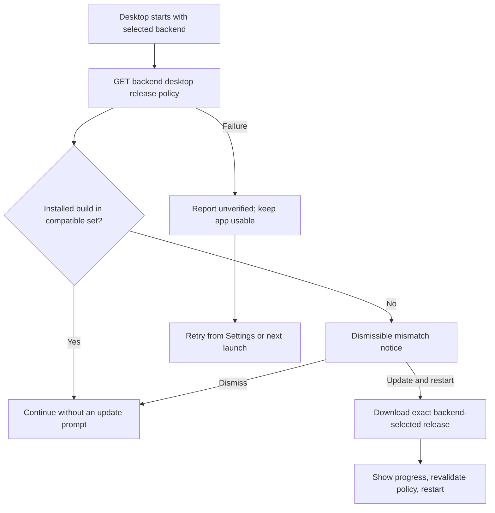
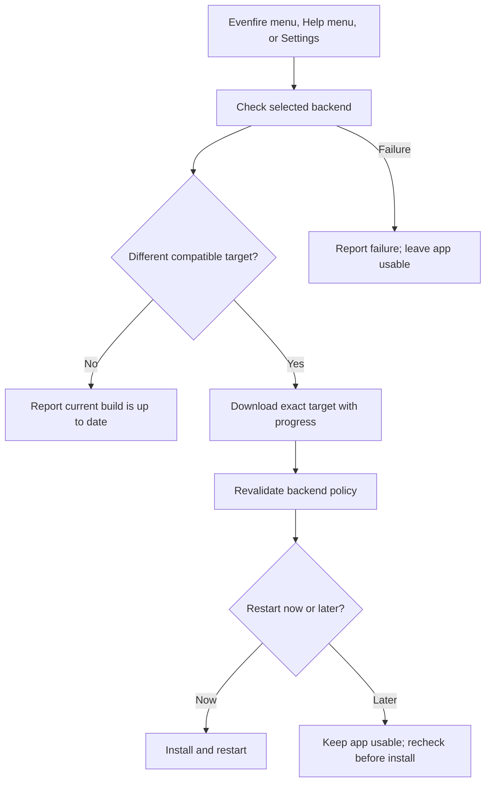

# Desktop compatibility updates: implementation status and roadmap

Status: first implementation slice is in this branch; cross-platform release
qualification remains open. This is not evidence that signed packages have
shipped or that native update/restart journeys have passed on all targets.
Discovery baseline: October 23, 2026, America/Guatemala.

The [acceptance contract](desktop-backend-compatible-updates-spec.md) records
the inspected release history, owner-confirmed decisions, user flows, and
acceptance conditions. The closed-source invitation/member-registration and
landing integration is an independent post-release track.

## Current flow

Startup verification:

Manual check:

In both flows, compatibility is advisory: no mismatch, failed check, pending
download, ignored alert, or deferred restart intentionally disables use.

## Gap inventory

| Area                        | Implemented in this branch                                                                                                                                                                                | Remaining work                                                                                                                                                                                                  |
| --------------------------- | --------------------------------------------------------------------------------------------------------------------------------------------------------------------------------------------------------- | --------------------------------------------------------------------------------------------------------------------------------------------------------------------------------------------------------------- |
| Backend compatibility       | Public External REST API release metadata returns the deployment's target, exact compatible-version set, and version-tag feed URL. The target must be in the set.                                         | The policy is compiled into each API deployment. There is no dynamic policy UI, revision/expiry, per-platform eligibility, release revocation, or promotion check across replicas.                              |
| Version/release writer      | Release preparation updates the Desktop version and target. It defaults the compatible set to the new version and accepts repeated flags for additional certified versions. The legacy minimum is frozen. | Release operators must publish all update metadata/assets before deploying a new target. Automation does not yet prove that ordering.                                                                           |
| Startup check               | Checks when a selected backend is configured, whether or not the user is signed in. Compatible builds remain quiet; mismatch and failure do not impose a usage gate.                                      | Add packaged startup journeys for backend outage, missing policy, ignored mismatch, retry, and environment switching.                                                                                           |
| Manual check and notices    | macOS app menu, Windows/Linux Help menu, Settings button, non-modal notice, download progress, and restart-now/later state are wired.                                                                     | Verify native menu and accessible progress behavior in packaged apps. Add cancellation and explicit concurrent-request coverage.                                                                                |
| Main-process updater        | Uses electron-updater, exact release-tag feed validation, target rechecks before download/install, persisted manual pending state, and downgrade selection.                                               | Test stale-policy/backend switches, transfer failures, restart persistence, platform permissions, package integrity, and recovery.                                                                              |
| Build and publication       | electron-builder config and release workflow cover macOS and Windows x64/arm64, Linux AppImage/DEB/RPM x64/arm64, exact-tag asset publication, macOS signing/notarization, and Windows signing.           | Configure signing secrets and produce a real candidate release. Verify every asset and metadata file across the six OS/architecture target groups; test actual upgrades/downgrades on each pair.                |
| Recent-client transition    | The new client uses exact allowlist membership; old minimum-version policy is left in place for existing old clients. No legacy projection or historical backport is added.                               | The first updater-capable build must be installed through the normal one-time distribution process because earlier binaries cannot gain updater code remotely. Validate current in-window builds directly.      |
| Invitation/download handoff | Explicitly excluded from the core update release.                                                                                                                                                         | After release, carry a backend-selected version through optional member-registration email, Profile UI, and the landing resolver; select recipient OS/architecture and download directly without a GitHub page. |

## Confirmed compatibility decisions

- All currently used builds are within the last 30 days, per the owner. No
  compatibility shim, old-backend backport, broken-tag adapter, or historical
  maintenance build is required for older releases.
- Record that exclusion in implementation PR descriptions and future update
  work. Do not raise the historical minimum version: old clients still consume
  that field, and the new client uses the explicit compatible set.
- Compatibility is many-to-many. One backend may allow several Desktop builds,
  and the same build may appear in several deployment manifests. Each backend
  chooses its own recommended target.
- A compatible build is not prompted at startup, even if a newer compatible
  target exists. Manual checks may download the selected target and ask whether
  to restart now or later.
- Always attempt verification when a configured backend is available. If it
  fails, say it failed, keep the app usable, and retry from Settings or on the
  next launch.
- Never intentionally block use because of mismatch, failure, pending update,
  ignored alert, or deferred restart. Existing service/auth errors still behave
  normally.
- Invitation emails, the member-registration repository, Profile UI download
  action, and landing versioned download links are post-release work only.

## Ordered work and release gates

### M0 — Product decisions and legacy boundary: complete

The owner confirmed startup/manual behavior, non-blocking failure/mismatch
handling, the recent-build baseline, and post-release invitation scope. No open
product question remains.

### M1 — Backend policy and release coordinates: implemented, deployment proof open

The current External REST API manifest contains the exact compatible set and
recommended target. The route returns only public version/release metadata. The
release writer validates the set and freezes the legacy minimum.

Before rollout, demonstrate two independently configured backend deployments
with different targets, multiple compatible versions, and a shared compatible
build. Confirm that each deployment retains its policy during separate release
timing.

### M2 — Native package build and publication: implemented, real release open

The workflow requires repository secrets:

- `DESKTOP_MACOS_CSC_LINK` and `DESKTOP_MACOS_CSC_KEY_PASSWORD`
- `DESKTOP_APPLE_API_KEY_P8`, `DESKTOP_APPLE_API_KEY_ID`, and `DESKTOP_APPLE_API_ISSUER`
- `DESKTOP_WINDOWS_CSC_LINK` and `DESKTOP_WINDOWS_CSC_KEY_PASSWORD`

Configure these before a release. Build and inspect every platform/architecture
asset, updater metadata file, embedded app version, signing identity, and
download hash. Verify that target promotion cannot precede asset availability.
The workflow runs after a GitHub Release is published, so release sequencing
remains an explicit operational gap until an artifact-first promotion path is
proven.

electron-updater documents macOS DMG, Windows NSIS, and Linux AppImage/DEB/RPM
as update-capable formats; macOS must be signed:
[official auto-update documentation](https://www.electron.build/v26/docs/features/auto-update/).
Documentation does not replace testing installed packages, permissions,
downgrades, signing, or restart behavior.

### M3 — Main-process state and platform behavior: implemented, resilience proof open

Test the exact-feed and membership checks, failure recovery, user-data marker
persistence, backend switching, offline operation, incomplete downloads,
permissions, and the platform package updater behavior. Confirm a failed or
cancelled update leaves the current application working.

### M4 — User controls and UX: implemented, packaged UX proof open

Verify the native macOS Evenfire menu, Windows/Linux Help menu, Settings
control, startup mismatch notice, visible transfer progress, no modal usage
gate, immediate restart after the explicit startup action, and manual
restart-now/later behavior. Exercise both compatible-old and incompatible-new
clients against independent backend policies.

### M5 — Release qualification: not complete

Before calling the feature production-ready:

1. Use the verified Node 24.22.1 runtime and electron runtime. Build signed
   packages for macOS, Windows, and Linux on x64 and arm64.
2. Install each supported format and run a user-selected upgrade and downgrade.
   Record source/target versions, selected backend policy, architecture,
   package/signature identity, progress, restart, and post-restart compatibility.
3. Test failed backend checks, missing target assets, interrupted downloads,
   permission prompts, deferred restart, ignored alerts, and backend switching.
   Confirm normal app activity remains available in each advisory state.
4. Confirm release policy is activated only after the exact-tag assets and feed
   metadata can be downloaded for every required architecture.
5. Publish current user instructions for the first updater-capable installation.
   Existing binaries without updater code cannot update themselves.
6. Put versioned invitation and landing downloads in a separate post-release
   project; do not make them a release prerequisite.

## Validation completed in this branch

- External REST API desktop release route: 4 focused tests pass.
- Release coordinate contract: 36 assertions pass, including freezing the
  historical minimum and validating the compatible version set.
- Desktop unit/UI coverage and build/type checks: see the PR validation summary.
  These checks do not prove signed native installation behavior.
- Signing secrets were unavailable, so no published packages or native
  upgrade/downgrade journeys are claimed.

Legacy releases outside the owner-confirmed recent baseline are explicitly out
of scope. The first updater-capable build requires a normal one-time install for
existing users; all subsequent supported update decisions come from their
selected backend.
