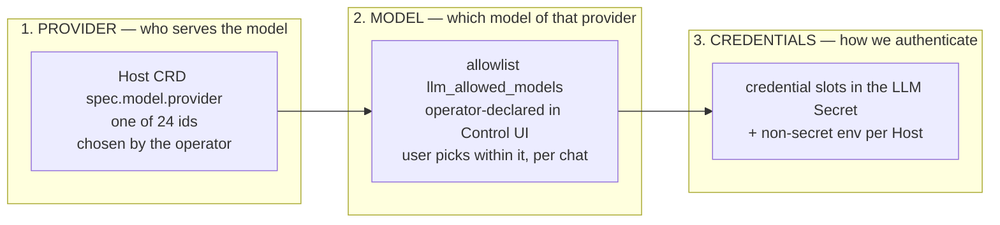
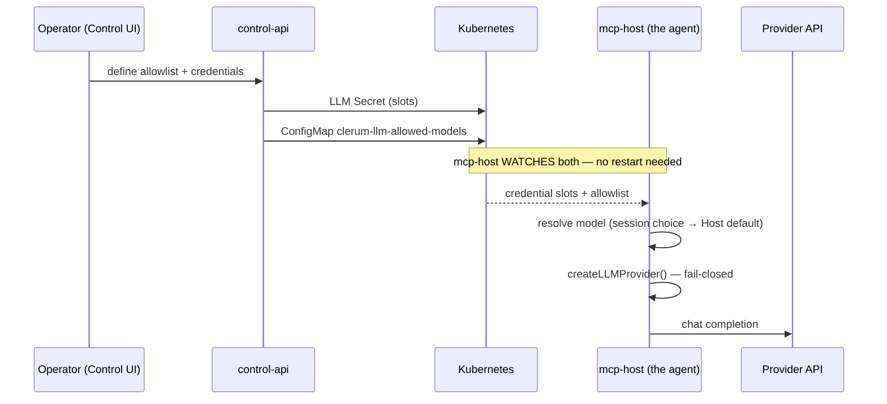

# LLM providers — how they work, which are supported, how to configure them

This is the orientation guide. Read it first, then branch:

| You want to…                               | Go to                                        |
| ------------------------------------------ | -------------------------------------------- |
| Set up credentials and the model allowlist | [Operator guide](../deploy/llm-providers.md) |
| Add a provider that isn't in the list      | [Adding a provider](adding-a-provider.md)    |
| Understand the Control UI surface          | [Control UI](../surfaces/control-ui.md)      |

> Code and API group still use the historical name **clerum** (`clerum.io`,
> `CLERUM_*`, `@clerum/*`). Same project — [code names](../concepts/code-names.md).

---

## 1. The mental model: three independent things

The single most common confusion is treating "provider", "model" and "credential"
as one setting. They are three separate axes, configured in three different places
by (potentially) three different people.



A few rules that follow from this split, and that surprise people:

- **A Host is bound to exactly one provider.** There is no per-message provider
  switching. Changing provider means editing the Host.
- **The credential belongs to the provider, not to the model.** Every model of a
  provider resolves to the same credential. (This was not always true — the old
  `provider__model` mapping is retired.)
- **A model is usable only if the operator allowlisted it.** Fail-closed: a row
  must exist in `llm_allowed_models` for `(provider, model)` with `enabled = true`.
  Installing a provider does _not_ make its models available.
- **A credential can have more than one part.** `bedrock` needs two keys; `vertex`
  needs a whole service-account JSON. The code models this as _slots_, not as "the
  API key".

---

## 2. Which providers are supported

**24 providers**, defined once in
[`packages/llm-providers/index.cjs`](../../packages/llm-providers/index.cjs) —
the single source of truth consumed by mcp-host, control-api, the workflow
runtime, the host controller and the Control UI.

They differ only in _how much code_ the integration needs. That is the axis that
determines everything else (which config they need, where they work, what can go
wrong):

### Group A — OpenAI-compatible, pure data (17)

These speak an OpenAI-compatible `/chat/completions` API. Integrating them is a
`baseURL` + one API key, **no driver code**. They are all handled by one shared
class, `OpenAICompatibleProvider`.

| Provider      | id           | Credential slot      | Default model                                       |
| ------------- | ------------ | -------------------- | --------------------------------------------------- |
| Z.AI          | `zai`        | `zai-api-key`        | `glm-5.1`                                           |
| Bailian       | `bailian`    | `bailian-api-key`    | `qwen3-coder-plus`                                  |
| OpenRouter    | `openrouter` | `openrouter-api-key` | `anthropic/claude-sonnet-latest`                    |
| Google Gemini | `gemini`     | `gemini-api-key`     | `gemini-2.5-flash`                                  |
| DeepSeek      | `deepseek`   | `deepseek-api-key`   | `deepseek-v4-flash`                                 |
| Groq          | `groq`       | `groq-api-key`       | `llama-3.3-70b-versatile`                           |
| Together AI   | `together`   | `together-api-key`   | `meta-llama/Llama-3.3-70B-Instruct-Turbo`           |
| Fireworks AI  | `fireworks`  | `fireworks-api-key`  | `accounts/fireworks/models/llama-v3p3-70b-instruct` |
| Mistral AI    | `mistral`    | `mistral-api-key`    | `mistral-medium-latest`                             |
| xAI (Grok)    | `xai`        | `xai-api-key`        | `grok-4.3`                                          |
| Cerebras      | `cerebras`   | `cerebras-api-key`   | `gpt-oss-120b`                                      |
| DeepInfra     | `deepinfra`  | `deepinfra-api-key`  | `deepseek-ai/DeepSeek-V3.2`                         |
| Perplexity    | `perplexity` | `perplexity-api-key` | `sonar-pro`                                         |
| Moonshot      | `moonshot`   | `moonshot-api-key`   | `kimi-k2.6`                                         |
| Nebius        | `nebius`     | `nebius-api-key`     | `Qwen/Qwen3-235B-A22B-Instruct-2507`                |
| Novita AI     | `novita`     | `novita-api-key`     | `deepseek/deepseek-v3.2`                            |
| MiniMax       | `minimax`    | `minimax-api-key`    | `MiniMax-M2`                                        |

`openai` itself also speaks this protocol but uses the official SDK (Group B).

### Group B — own SDK / bespoke wire protocol (4)

| Provider         | id        | Credential slots                                  | Non-secret env (per Host)                    |
| ---------------- | --------- | ------------------------------------------------- | -------------------------------------------- |
| OpenAI           | `openai`  | `openai-api-key`                                  | —                                            |
| Anthropic        | `claude`  | `claude-api-key`                                  | —                                            |
| Google Vertex AI | `vertex`  | `vertex-service-account-json` _(multi-line JSON)_ | `VERTEX_PROJECT_ID` (req), `VERTEX_LOCATION` |
| Amazon Bedrock   | `bedrock` | `aws-access-key-id` **+** `aws-secret-access-key` | `AWS_REGION` (required)                      |

`claude` is the only provider that ships its own token counter; everything except
`openai`/`azure` uses a fallback counter, so **token counts for Group A and for
Vertex/Bedrock are approximations**, not provider-exact.

### Group C — light driver (1)

| Provider     | id      | Credential slot        | Non-secret env (per Host)                                 |
| ------------ | ------- | ---------------------- | --------------------------------------------------------- |
| Azure OpenAI | `azure` | `azure-openai-api-key` | `AZURE_OPENAI_ENDPOINT` (req), `AZURE_OPENAI_API_VERSION` |

Azure is OpenAI-shaped but has no fixed base URL (per-resource endpoint), it
authenticates with an `api-key` header instead of `Authorization: Bearer`, and
**its "model" is your Azure deployment name**, not a catalog id.

### Group D — subscription sign-in, no API key (2)

| Provider                     | id                   | Credential                                        | Feature flags (all default `false` in `deploy/base`)                                                                                                         |
| ---------------------------- | -------------------- | ------------------------------------------------- | ------------------------------------------------------------------------------------------------------------------------------------------------------------ |
| ChatGPT (Codex) subscription | `codex-subscription` | OAuth sign-in held by control-api, no Secret slot | `CONTROL_API_CODEX_SUBSCRIPTION_ENABLED`, `CODEX_LLM_PROXY_EXECUTION_ENABLED`, `MCP_HOST_CODEX_SUBSCRIPTION_ENABLED`                                         |
| Grok subscription            | `grok-subscription`  | OAuth sign-in held by control-api, no Secret slot | `CONTROL_API_GROK_SUBSCRIPTION_ENABLED`, `GROK_LLM_PROXY_EXECUTION_ENABLED`, `WRC_GROK_SUBSCRIPTION_ENABLED` (recipes); mcp-host's flag is injected per Host |

These providers use a subscription account instead of an API key. An admin
signs in from Control UI (**Secrets → LLM Subscriptions** tab,
`/secrets/llm/subscriptions`); control-api
keeps the OAuth tokens, and model traffic goes through the in-cluster
`codex-llm-proxy` / `grok-llm-proxy`. A Host selects a sign-in with
`spec.model.connectionRef` and needs no `secretRef` when every target is
the same subscription provider. A Host may use at most one subscription
provider. They are **off in `deploy/base`** and switched on in the minikube
overlay. Setup guide:
[Use a ChatGPT or Grok subscription](../how-to/connect-llm-subscription.md).
Wire-level details:
[Codex transport contract](../architecture/codex-subscription-transport-contract.md),
[Grok transport contract](../architecture/grok-subscription-transport-contract.md).

### Important: not every provider works everywhere

| Surface                       | Providers supported                                  |
| ----------------------------- | ---------------------------------------------------- |
| Interactive Host (chat agent) | all **24** (subscription providers need their flags) |
| WorkflowRecipe LLM steps      | **22** — `bedrock` and `azure` excluded              |

`bedrock` and `azure` are deliberately absent from the WorkflowRecipe CRD enum:
the workflow `configure` transport carries a **single** credential string, so it
cannot deliver Bedrock's key pair nor Azure's required endpoint. Excluding them
makes the recipe fail at admission rather than mid-run.

---

## 3. How a request actually flows



Two properties worth internalising:

1. **Everything is watch-based.** mcp-host holds four watches (`host-secret`,
   `host-cm`, `llm-secret`, `allowlist-cm`) with precedence
   `host-secret > host-cm > llm-secret > process.env`. Rotating a key or editing
   the allowlist propagates in about a second — **no pod restart, no redeploy**.
2. **mcp-host never calls control-api for this.** The allowlist reaches the
   runtime as a ConfigMap watch, never an API call, so a control-api outage
   cannot break a running agent. Direct mcp-host → control-api traffic is denied
   by the NetworkPolicy; the only allowed control-plane lane is the
   workflow-approval gateway.

### Fail-closed at every step

`createLLMProvider()` returns `null` (degraded, never a crash) if the provider id
is unknown, **or if any _required_ credential slot is missing**. This is why
Bedrock with only one of its two AWS keys is rejected up front instead of
surfacing as an opaque `401` on the first message.

---

## 4. Configuring a provider

### 4.1 The general shape

1. **Credentials** → Control UI **Secrets → LLM**. The form renders one group per
   provider, derived from the shared package. It is **write-only**: values are
   never read back, only key names. To rotate, re-enter.
2. **Non-secret config** (region, project, endpoint) → Control UI
   **Host → Environment**. These are _not_ credentials and never belong in the
   Secret.
3. **Allowlist the models** → Control UI **LLM Models** (`/llm-models`). Nothing
   is usable until this exists.
4. **Point the Host at it** → `spec.model.provider` + `spec.model.name`, via the
   Host wizard or the CRD.

### 4.2 A plain API-key provider (Groq, Mistral, DeepSeek, …)

Paste the key into its field under **Secrets → LLM**, allowlist at least one
model, set the Host's provider and model. That's all — no env vars, no code.

### 4.3–4.5 Bedrock, Vertex AI, Azure OpenAI

These need more than one value: Bedrock takes a key pair saved together plus
`AWS_REGION`; Vertex takes a service-account JSON plus `VERTEX_PROJECT_ID`;
Azure takes a key plus `AZURE_OPENAI_ENDPOINT`, and its model name is your
deployment name. Step-by-step setup is in the operator guide:
[Vertex AI](../deploy/llm-providers.md#2-configuring-google-vertex-ai) ·
[Bedrock](../deploy/llm-providers.md#3-configuring-amazon-bedrock) ·
[Azure OpenAI](../deploy/llm-providers.md#3a-configuring-azure-openai).

### 4.6 Local development (no Kubernetes)

Dev mode bypasses the Kubernetes setup above (Secrets, Host CRs). Set
`CLERUM_DEV_MODE=true` and export the provider's env var(s) — `OPENAI_API_KEY`,
`GROQ_API_KEY`, `AWS_ACCESS_KEY_ID` + `AWS_SECRET_ACCESS_KEY`, etc. Bedrock
also needs `AWS_REGION` to run: the two keys are enough for auto-selection, but
without the region the provider fails to construct and mcp-host runs degraded.
Azure likewise needs `AZURE_OPENAI_ENDPOINT`. If `CLERUM_MODEL_PROVIDER` is unset, mcp-host
**auto-detects** the first provider (in the canonical id order) whose required
slots are all present and uses that provider's default model;
`CLERUM_MODEL_NAME` applies only when `CLERUM_MODEL_PROVIDER` is also set.

> One gotcha: because Bedrock's slots are the standard AWS variable names, a
> shell that already exports generic AWS credentials can
> auto-select `bedrock`. Set `CLERUM_MODEL_PROVIDER` explicitly if that's not
> what you want.

### 4.7 Local minikube (`make minikube-setup`)

`scripts/minikube/full-setup.sh` step 6f writes the `chatllm` Host's
`spec.model` from `.env`, by the rule in `scripts/minikube/host-model.sh`:

| `.env`                                        | Host model                                                                                                          |
| --------------------------------------------- | ------------------------------------------------------------------------------------------------------------------- |
| `CLERUM_MODEL_PROVIDER` + `CLERUM_MODEL_NAME` | used as given                                                                                                       |
| `CLERUM_MODEL_PROVIDER` only                  | that provider's default model (openai, claude, zai, bailian)                                                        |
| `CLERUM_MODEL_NAME` only                      | **refused** — setup exits 1 naming both variables                                                                   |
| neither, one or more of the four keys         | first key in the order `OPENAI_API_KEY`, `CLAUDE_API_KEY`, `ZAI_API_KEY`, `BAILIAN_API_KEY`, with its default model |
| neither, no key                               | `openai/gpt-5.4-mini`, with a warning that the agent will not reply                                                 |

The default models are the `defaultModel` values in
`mcp-host/src/llm/registryCore.ts`. Any other provider needs both variables.

A name without a provider is refused because a model id belongs to one
provider: pairing `CLERUM_MODEL_NAME=glm-4.7` with whichever key is present
produced `openai/glm-4.7`, which no catalog serves.

No model catalog is seeded, so a fresh database's allowlist holds only what
control-api's catalog sync enabled (section 5). Setup therefore needs egress to
models.dev, and it handles the Host model in three steps:

1. **Step 6f waits for the first catalog sync.** It reads
   `llm_catalog_sync_runs` until a run used the live catalog, for up to
   `CLERUM_CATALOG_WAIT_SECONDS` (default 180; `0` checks once). It warns and
   continues on `CATALOG_SYNC_VENDORED_ONLY` (only the offline snapshot was
   used: no egress, or `MODELS_DEV_API_URL` unreachable) or
   `CATALOG_SYNC_PENDING` (no run yet). It then classifies the pair as
   enabled, disabled or not in the allowlist. It writes nothing: there is no
   admin yet, and an admin login before step 10 would consume the one-shot
   `/admin/auth/setup`.
2. **Step 10 adds or enables the model through the admin API**, with the
   seed's own admin session (`scripts/e2e/llm-model-ensure.sh`). A missing pair
   is created as a manual row, enabled. A disabled row is enabled when this run
   created the database, or when the catalog sync inserted it during this run
   (after the seed's first read, for example a `409` on the create). Each pair
   logs `LLM_MODEL_ENSURED <created|enabled|present|skipped-reuse> provider/model`,
   and setup prints every such line after the seed. This happens only on the
   minikube profile setup is running (any profile name, including
   pre-hash branch profiles such as `clerum-oauth19`); a direct
   `seed-test-data.sh` run accepts only `clerum-test` and hashed branch
   profiles.

   If 6f did not see a live catalog run, the seed checks again for up to
   `LLM_ENSURE_CATALOG_WAIT_SECONDS` (default 60) before creating rows. If the
   catalog is still undecided it creates them anyway and warns
   `LLM_MODEL_ENSURE_BEFORE_CATALOG`: such rows stay manual, with no catalog
   price or lifecycle status, even for models models.dev lists.

3. **After step 10 the pair must be an enabled row**, or setup exits 1 with
   `HOST_MODEL_UNKNOWN` (no row), `HOST_MODEL_DISABLED` (row disabled) or
   `HOST_MODEL_CHECK_FAILED` (the query could not run).

Why step 10 has work to do on a fresh install:

- models.dev does not list the zai default `glm-5.1`, so no sync creates it;
- `bailian` ships with auto-enable OFF, so with only `BAILIAN_API_KEY` nothing
  of Bailian's is enabled, and `qwen3-coder-plus` is also deprecated in the
  catalog;
- models the catalog marks deprecated (for example `zai/glm-4.7`) are
  inserted disabled.

A row setup creates this way has no catalog price, so `cost` budgets do not
limit it until an admin prices it under **Cost → LLM prices** (the
[upgrade note](../deploy/llm-catalog-seed-retirement-upgrade.md) explains how
unpriced models count).

On a **reused database** (`REUSE_DB=true` / `--keep-db`) setup does not
re-enable a row that was already disabled when the seed read it, and never
re-creates a pair an operator removed: either may be an operator's decision.
(A row the catalog sync inserts during the run is enabled, as above.) A
disabled Host model stops setup at step 6f with `HOST_MODEL_DISABLED`, and a
removed one with `HOST_MODEL_DISMISSED`; other pairs log
`LLM_MODEL_ENSURE_SKIPPED_REUSE`. Enable them under **LLM models** in the
Control UI.

With **`--defer-bootstrap-seed`** step 10 does not run, so setup only warns
`HOST_MODEL_PENDING`, whether the Host model is missing or disabled and even on
a reused database, and the agent does not reply until an admin adds or enables
the model in the Control UI after the browser setup.

The **e2e seed profile** also enables every pair in
`scripts/e2e/e2e-llm-models.txt` (the models the E2E specs and lanes use), the
`E2E_WORKFLOW_MODEL_PROVIDER`/`E2E_WORKFLOW_MODEL_NAME` pair when both are set,
and the Plugin Workload SDK demo model.
`scripts/tests/test-e2e-llm-models-manifest.sh` fails when an E2E file names a
pair the manifest lacks.

Outside minikube nothing provisions models for you. On any other installation
an admin adds or enables the Host's model under **LLM models** (or with
`POST`/`PUT /admin/llm-models`) when the catalog did not.

---

## 5. The model allowlist

The set of usable models is **operator-declared, not a shipped catalog**. It
lives in the control-api Postgres table `llm_allowed_models`, is managed at
`/llm-models`, is fully audited (`llm_allowed_models_audit`), and is materialized
to the `clerum-llm-allowed-models` ConfigMap for the runtime.

In short: it is **fail-closed** (a model needs an enabled row), models already
deployed are never interrupted, and a missing ConfigMap degrades to "only the
configured model". The catalog sync inserts new models and enables them when
the provider's catalog policy is ON (direct vendors by default), the model is
eligible (text output, `tool_call`, no catalog `status` of any kind, an id the
runtime can execute) and the run fetched models.dev live; at most
`LLM_CATALOG_AUTO_ENABLE_MAX_PER_PROVIDER_PER_RUN` per provider and
`LLM_CATALOG_AUTO_ENABLE_MAX_PER_RUN` in total per run (newest releases first
within a provider; the total is handed out in the fixed order of
`PROVIDER_IDS`, so later providers wait for earlier ones), and a large catalog
completes over several runs. It also loads the catalog price of each model it
inserts. It never changes `enabled` on an existing row. Without egress
(`vendored` runs) providers whose policy is ON get no discovered rows, and
since nothing is seeded, a fresh installation without egress has no enabled
model at all until an admin adds one (local minikube setup adds the Host's
model itself, section 4.7). Operator
details (policy, caps, offline installations, emergency brake, propagation,
metrics, degraded mode) are in the
[operator guide](../deploy/llm-providers.md#5-the-model-allowlist).

### Image input capability (`image_input`)

Whether a model accepts images is a property of the **(provider, model) pair**,
declared per row and backed by evidence — never inferred from the model name, its
family, or an "OpenAI-compatible" request shape.

- Each row carries `image_input` (`{ state, evidence? }`). Absent or malformed
  metadata reads as `unknown`. `supported` / `unsupported` require evidence: a
  public `https://` documentation reference with no query string, fragment or
  userinfo (or a sanitized `evidence:<id>`) plus the date it was read.
  `validUntil` is required for any discovery-sourced `supported` / `unsupported`
  and equals `checkedAt + LLM_CATALOG_IMAGE_EVIDENCE_TTL_MS` (default 30 days);
  curated evidence carries it only when the vendor document states an expiry.
- **Unknown blocks images, never text.** Text-only chat keeps working on an
  unverified model; attaching an image is what stops, with the model and the
  reason surfaced.
- The catalog sync derives `supported` / `unsupported` from models.dev
  `modalities.input` (`image` present / absent) and records `unknown` when the
  entry has no usable `modalities`; `attachment` is not consulted. Discovery
  evidence never overwrites curated evidence and never overwrites newer
  discovery evidence.
- **Transport is a second gate.** Even `supported` evidence is refused when the
  Host's driver family has no image serializer for the dispatch method
  (`TRANSPORT_SUPPORT` in `mcp-host/src/llm/imageInput.ts`); the Desktop shows
  this as a transport refusal, not as a model refusal.
- Renaming a row's provider or model clears its evidence (it belonged to the old
  pair), and editing capability never changes `enabled`.
- A capability change re-materializes the ConfigMap `imageInput` field, so
  running Hosts pick it up without a redeploy. The sync re-materializes
  `clerum-llm-allowed-models` whenever its content differs from Postgres (an
  `image_input` change on an enabled row, a model it enabled on insert); it
  never enables or disables an existing row, nor edits any other served column
  of one.

#### Rollout and refresh cadence

- On upgrade, migration `011b_llm_allowed_models_image_input` only adds the
  nullable column and its `CHECK`; it seeds no evidence. Existing rows stay `unknown` (images refused, text unaffected) until a
  catalog sync runs, on demand or from the cron. With the cron enabled (the
  base deploy enables it) the first sync runs a few seconds after control-api
  starts, not one interval later, and fills every row whose pair models.dev
  lists (on an installation upgraded from a release that seeded a default
  catalog, 28 of the 44 seeded pairs). Rows models.dev does not list (ids an
  operator added by hand and, on such an upgraded installation, the other 16
  seeded pairs, which stay `manual`; see the
  [upgrade note](../deploy/llm-catalog-seed-retirement-upgrade.md)) stay
  `unknown` until an operator
  curates them through the admin API
  (`PUT /admin/llm-models/:id` with an `image_input` field; see
  [adding-a-provider.md](adding-a-provider.md)).
- Discovery evidence expires `LLM_CATALOG_IMAGE_EVIDENCE_TTL_MS` after the
  capture it came from. An expired claim resolves to `unknown` with reason
  `evidence_expired`, and images are refused with that reason until the next
  sync.
- With `LLM_CATALOG_SYNC_CRON_ENABLED=true` (code default off; set to `true` in
  `deploy/base/control-plane/configmaps.yaml`) the refresh is automatic: one
  sync shortly after start, then one every `LLM_CATALOG_SYNC_INTERVAL_MS`; the config refuses a TTL shorter than twice
  `LLM_CATALOG_SYNC_INTERVAL_MS`. Each run enables at most
  `LLM_CATALOG_AUTO_ENABLE_MAX_PER_PROVIDER_PER_RUN` (default 100) new models
  per provider and `LLM_CATALOG_AUTO_ENABLE_MAX_PER_RUN` (default 300) in total;
  both accept 1–1000 and the rest wait for the next sync run (with the cron off,
  a manual sync or a restart), the providers further
  down `PROVIDER_IDS` after the ones ahead of them. Without the cron, one boot
  sync still runs a few seconds after start (`LLM_CATALOG_BOOT_SYNC_ENABLED`,
  default `true`), so run
  `POST /admin/llm-models/discovery/sync` at least once per TTL (monthly at the
  default; every two weeks leaves margin). The endpoint runs the same code path
  as the cron.
- A vendored (offline) run stamps evidence with the snapshot's capture date, so
  it cannot keep evidence live past `capture + TTL`. Regenerate the snapshot with
  `control-api/scripts/regenerate-models-dev-snapshot.mjs` (after
  `npm run build` in `control-api`) when shipping a release.

Beyond the global allowlist there are two narrower scopes:

| Scope         | Where                                       | Purpose                                 |
| ------------- | ------------------------------------------- | --------------------------------------- |
| Global        | `llm_allowed_models`                        | what the cluster may use at all         |
| Per Host      | `spec.allowedModels`                        | narrow one Host to a subset             |
| Per SDK grant | `plugin_workload_sdk_grants.allowed_models` | what one recipe's promptBridge may call |

---

## 6. Choosing a model as a user

The desktop app has a per-chat model selector, Claude-Code style, restricted to
the allowlist:

- The choice is **session state, not process state** — one Host serves many users
  and chats, so your switch never touches anyone else's.
- It applies **from your next message**; in-flight tasks finish on the model they
  started with.
- It survives restarts. If the saved model later leaves the allowlist, the agent
  falls back to the Host default and says so.
- You can change the _model_, not the _provider_ — the provider is the operator's
  decision.

Operator-side details (scopes, context-window indicator, usage attribution):
[operator guide §6](../deploy/llm-providers.md#6-the-per-session-model-selector-desktop-app).

---

## 7. Provider fallback

A Host may declare `spec.llmPolicy` with an ordered `fallbacks[]` list, so that a
primary failure (outage, exhausted credit, banned key) fails over instead of
failing the chat. It is **opt-in** — no policy means no behaviour change.

Failover is sticky with a cooldown (default 300s) and recovers lazily. Each entry
is a fixed `(provider, model)` pair and may pin a `credentialSlot` — an extra key
in the _same_ Secret (e.g. `claude-api-key-fb1`), which is how "same provider,
different key" works. Triggers are a closed catalogue mapped onto the error
classifier: `insufficient_quota` (402), `auth` (401/403), `rate_limited` (429),
`provider_unavailable` (5xx/529 and retryable transport errors). Deliberately
**not** eligible: non-retryable `400`s, validation and content-policy errors —
failing over on those would just mask bugs.

---

## 8. Troubleshooting

| Symptom                                                  | Cause                                                                                                                                                                                                                                  |
| -------------------------------------------------------- | -------------------------------------------------------------------------------------------------------------------------------------------------------------------------------------------------------------------------------------- |
| Agent degraded, log `Required LLM credential is missing` | A required slot is missing. Bedrock needs **both** keys.                                                                                                                                                                               |
| Agent degraded, log `Failed to construct LLM provider`   | The log names neither provider nor cause. Check `AWS_REGION` (Bedrock), `AZURE_OPENAI_ENDPOINT` (Azure), or the Vertex JSON; Vertex uses the JSON's `project_id` when `VERTEX_PROJECT_ID` is unset and fails only if both are missing. |
| `403 model_not_allowed`                                  | Model isn't allowlisted/enabled for that provider.                                                                                                                                                                                     |
| `404 No secret mapping found` (workflow step)            | Provider has no entry in `clerum-model-secret-mapping` — see below.                                                                                                                                                                    |
| `500 ConfigMap not found` (workflow step)                | `clerum-model-secret-mapping` missing from the `mcp-host` namespace.                                                                                                                                                                   |
| `502 mcp_host configure failed/unreachable`              | WRC resolved the credential but couldn't configure mcp-host.                                                                                                                                                                           |
| Model dropdown empty in the wizard                       | No enabled allowlist rows for that provider.                                                                                                                                                                                           |
| Context-window indicator looks wrong                     | `context_window_tokens` unset on the allowlist row → falls back to `CLERUM_CONTEXT_MAX_TOKENS`.                                                                                                                                        |
| Cost report shows a model as unpriced                    | No row in `llm_model_prices`. The catalog sync prices a model only when it inserts it and models.dev has a cost; nothing is seeded. Add one under **Cost → LLM prices**.                                                               |

### Known sharp edge: workflow steps and the secret mapping

The WorkflowRecipe CRD admits **22** providers, but the shipped
`clerum-model-secret-mapping` ConfigMap
([`deploy/base/mcp-host/model-secret-mapping.yaml`](../../deploy/base/mcp-host/model-secret-mapping.yaml))
maps only **five**: `openai`, `claude`, `zai`, `bailian`, `vertex`.

A recipe pinning any of the other 15 (`groq`, `mistral`, `xai`, `minimax`, …) passes
admission and then fails at runtime with `404 No secret mapping found`. This
ConfigMap is declarative — nothing generates it — so to use those providers in
workflows an operator must add the entry themselves:

```yaml
data:
  groq: 'chatllm-api-keys/groq-api-key'
```

Interactive Hosts are unaffected: they resolve credentials through the
ConfigStore, not this mapping.

---

## 9. Where things live in the code

| Concern                                            | Location                                              |
| -------------------------------------------------- | ----------------------------------------------------- |
| Canonical provider ids, slots, labels, env         | `packages/llm-providers/index.cjs`                    |
| Runtime fields (baseURL, default model, tokenizer) | `mcp-host/src/llm/registryCore.ts`                    |
| Provider construction (`makeProvider`)             | `mcp-host/src/llm/registry.ts`                        |
| Fail-closed entry point                            | `mcp-host/src/llm/index.ts`                           |
| Own-SDK drivers                                    | `mcp-host/src/llm/drivers/`                           |
| Credential watches / exclusion boundary            | `mcp-host/src/config/configStore.ts`                  |
| Allowlist CRUD + ConfigMap materialization         | `control-api/src/routes/admin/llmModels.ts`           |
| Host spec validation (model, policy, subset)       | `control-api/src/routes/admin/hostSpecValidation.ts`  |
| Workflow secret broker                             | `workflow-recipes/src/workflow/modelConfigHandler.ts` |
| UI provider/model metadata                         | `control-ui/lib/llm.ts`                               |
| CRD enums                                          | `charts/clerum-crds/crds/{host,workflowrecipe}.yaml`  |

A note on secrets hygiene: no provider credential — for **any** provider, whether
configured or not — reaches a tool subprocess through the ConfigStore boundary.
The exclusion set is derived from the full slot list of every provider _plus_
whatever the LLM Secret actually delivers, so dynamically-named fallback slots
are covered too. The shell tool additionally strips every non-active provider's
slots from the child env; keep provider key names out of `CLERUM_ENV_ALLOWLIST`
so the active provider's key stays out of subprocesses as well.

Adding a provider is usually a data change, not a code change — see
[Adding a provider](adding-a-provider.md).
