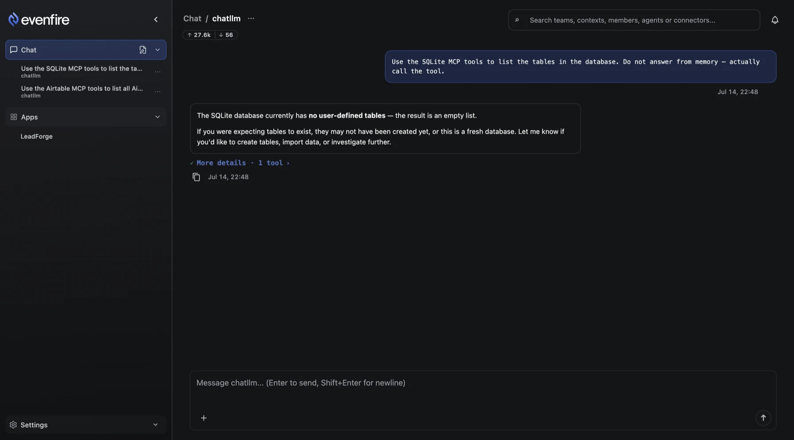
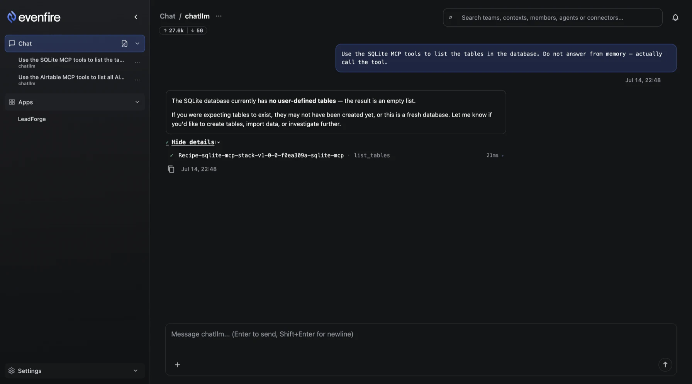
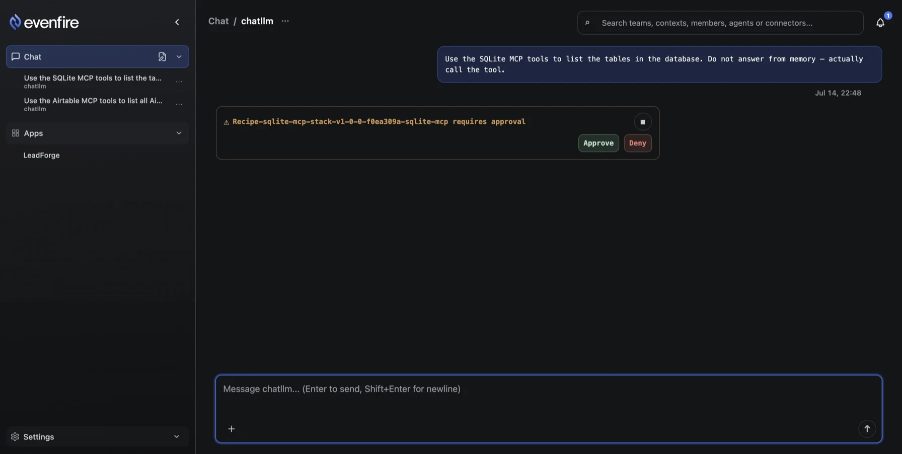
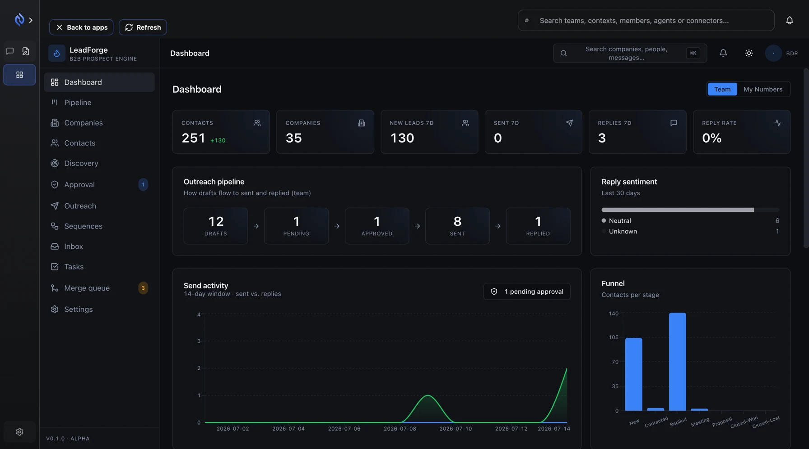
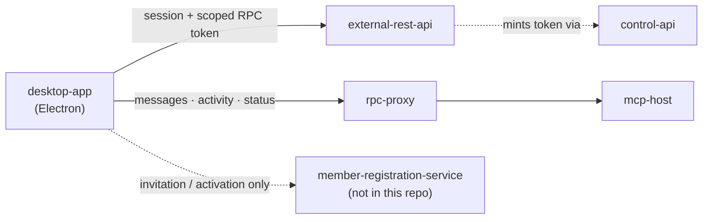

# Desktop App

Desktop App is an Electron client with a React renderer (built with Vite),
packaged as **Evenfire** with Electron Forge. It is the end-user surface: how
a person who is not the platform admin actually drives an agent, with no
Telegram bot and no curl in sight. It authenticates through
`external-rest-api`, obtains short-lived scoped RPC tokens, and does
everything else — messages, activity, approvals, sandbox UIs — through
`rpc-proxy`. It **never holds a `control-api` token**: no secrets, no cost
records, no admin control plane, no matter who is signed in. The one
control-plane resource an end user reads is the `WorkflowRecipe` their user or
team is authorized for, and only through `external-rest-api`'s access-checked
passthrough. See [UI Surfaces](README.md) for how the three consoles divide the
platform, and the [Control UI](control-ui.md) for the admin side of that split.

## The daily loop

1. **Log in.** The sign-in screen offers email and password, posted to
   `POST /api/v1/auth/password-login`. (The main process also exposes a
   Google `idToken` login IPC, but no screen uses it today.) Once a session is
   established, it is restored from the OS keychain via `keytar`, with a
   local file fallback when no keychain is available.
2. **Pick a team.** Team listing and switching read the access catalog:
   `GET /api/v1/me/agents` and `GET /api/v1/me/contexts` for the signed-in
   user, `GET /api/v1/team/agents` and `GET /api/v1/team/contexts` for the
   active team.
3. **Pick an agent.** Authorized agents from the access catalog
   auto-populate the RPC token's default `hostRefs` — the app requests a
   token scoped to the agents you can actually see. Manual host refs still
   work as an override.
4. **Chat.** Sending a message is
   `POST /api/v1/rpc/hosts/:hostRef/messages`, through `rpc-proxy`. Each
   answer carries a collapsed summary of the tool calls behind it, plus the
   input and output token counts for the thread.

   
   _Dev cluster, demo tenant._

5. **Watch it work.** `ProgressStepper` renders the tool calls as they run —
   each step's tool name, how long it took, and the payload it returned.
   The client also subscribes to
   `GET /api/v1/rpc/hosts/:hostRef/activity/stream` (SSE) in
   `desktop-app/src/rpcProxyClient.ts`. Two honest limits, straight from
   `desktop-app/README.md`: that stream does **not** include internal
   reasoning / chain-of-thought content, and it is **read-only** — it is
   never used to submit messages, only to observe what is already running.

   
   _Dev cluster, demo tenant._

6. **Approve the gated call.** When a tool call needs a human decision, the
   `ProgressStepper` suspends the step in place and shows an in-chat
   Approve / Deny prompt — no separate screen, no context switch. Approving
   or denying is itself an RPC call scoped to `host:approval:write`. See
   [Configure approvals](../how-to/configure-approvals.md) for how the
   Required / Skip / Default policy behind that prompt is set.

   
   _Dev cluster, demo tenant._

7. **Collect the artifact.** Completed work surfaces through the
   `ArtifactsBadge`, alongside two related file surfaces: shared files
   (`SharedFilesTab`) scoped to a context, and the brokered Global File
   System for cross-context storage.

## Self-hosted initial admin access to GFS

In a self-hosted installation, the Desktop identity provisioned for the first
Control Admin during the supported `/admin/auth/setup` bootstrap is linked
directly to that exact Control Admin. The link grants GFS operator authority
only; it is not inferred from an email address, a password, or a later
invitation. No Control UI credential, admin password, or Control API token is
ever sent to or stored by Desktop.

The Control UI shows the exact Desktop-user/Control-Admin pair and its current
link state. An authenticated administrator can confirm **Revoke/disable Desktop
GFS operator access**. That action removes only the GFS operator link: it does
not delete or disable the Control Admin, change either password, remove either
identity, or alter unrelated Control Plane permissions. The next GFS request
from the Desktop session is denied, while ordinary user behavior remains
subject to its existing user-plane authorization.

Revocation is a retained lifecycle state, not a row deletion. The same Control
UI surface may explicitly **Reactivate Desktop GFS operator access** after a
confirmation; reactivation creates the next link generation and preserves the
revoked generation and its audit evidence. A stale generation or retired parent
is rejected rather than silently recreated or reassigned. Retiring a linked
Control Admin revokes its active generation and disables the admin in the same
transaction; physical purge is a separately governed retention operation.

This initial-setup link is deliberately separate from invitations and ordinary
member provisioning. Those flows do not create, repair, or reassign an operator
link.

## Screens

The app's top-level routes (`DESKTOP_ROUTES` in
`desktop-app/ui/src/constants/navigation.ts`) are: **Chat** (`chat`),
**Apps** (`sandbox-ui`), **Agents** (`agents`), **Connectors**
(`mcp-servers`), **Plugins** (`workflows`), **EvenDrive** (`files`), a file
`preview` view, and **Settings**. Inside an agent, the workspace has
Connectors, Members and Activity sub-routes (plus **Agent Files** when the
app is built with `VITE_SHOW_AGENT_FILES_UI`). Outside that
authenticated shell sit the first-run onboarding flow, the auth page (login),
and `UnavailablePage`, shown instead of login when a required backend
dependency is unreachable.

Two screens worth calling out specifically:

- **`McpServerHealthTable`** — per-connector health inside the agent
  workspace, so a broken MCP server is visible before you try to use it, not
  after.
- **Sandbox UIs** — recipe-supplied custom UIs render directly inside the
  desktop app (a dedicated Electron `WebContentsView`), proxied through
  `rpc-proxy` at `/api/v1/sandbox-ui/<namespace>/<name>/`. This is how a
  workflow recipe can ship its own interactive surface without becoming a
  fourth top-level product.

  Below, the LeadForge recipe's own dashboard runs inside the Desktop App's
  frame — the Desktop App's own navigation stays in charge, and
  everything the plugin's UI loads comes through `rpc-proxy`. The plugin gets
  a real interface; it does not get a second client to install.

  
  _Dev cluster, demo tenant. Captured before the "Back to apps" bar was
  removed; the sidebar now returns you to the app picker._

## How it is wired



The RPC access token is short-lived and scope-narrowed — `mcp:server:invoke`,
`host:message:invoke`, `host:approval:write`, `sandbox:ui:view`, and others,
one scope set per capability the app is about to use. `external-rest-api`
mints it via `control-api`, but the desktop app itself never talks to
`control-api` and never stores one of its service tokens. The full endpoint
and scope table lives in
[`desktop-app/README.md` ` Host Runtime Contract](../../desktop-app/README.md#host-runtime-contract-via-rpc-proxy) —
it is linked here rather than copied so the two cannot drift apart.

## Electron security posture

The renderer runs with `contextIsolation: true`, `sandbox: true`, and
`nodeIntegration: false`. Its only API surface into the privileged main
process is the preload bridge (`window.clerum.*`); there is no direct Node or
Electron API access from React code. IPC senders are validated in the main
process handlers before any privileged call runs.

## Run it

From the repository root:

```bash
make install-all && npm --prefix control-ui install
npm run app   # desktop app only
npm run ui    # Control UI, Desktop App, and Profile UI together
```

Both commands port-forward the same three services — control-api on `:8090`,
external-rest-api on `:8091`, rpc-proxy on `:8094` — via the
`minikube-pf-control-api`, `minikube-pf-external-api`, and
`minikube-pf-rpc-proxy` targets, wait for the ports to become reachable, start
the frontend process, and tear every port-forward down together on exit.
(`make minikube-pf-desktop` starts the same three forwards standalone.)

## Ship it to your users

Release packaging uses electron-forge (`desktop-app/forge.config.js`). The
updater consumes the same ZIPs and native packages produced by this process.

- **zip** — macOS, Windows, and Linux
- **dmg** — macOS
- **squirrel** — Windows (`EvenfireSetup.exe`)
- **deb** and **rpm** — Linux

### Prepare the toolchain

Packaging uses the same guard as every other Desktop build. Use Node 24.22.1 or later in the Node 24 line
(`engines.node` is `^24.22.1`), install with `npm ci` **without**
`--ignore-scripts` so Electron's `postinstall` downloads the runtime, then run
the check:

```bash
cd desktop-app
npm ci
npm run verify:electron   # fails unless Node is 24.x >=24.22.1 and `electron` resolves to a runtime
```

A skipped `postinstall` still lets `npm ci` exit 0; `verify:electron` is what
catches it. If it reports that Electron is not installed, switch to Node 24 and
rerun `npm ci`. Do not set `ELECTRON_SKIP_BINARY_DOWNLOAD`.

### Build installers

Six `npm` scripts in `desktop-app/package.json` drive the makers, each running
`electron-forge make --platform=<platform> --arch=<arch>`. Packaging runs
`npm run build` first through the forge `prePackage` hook (set
`EVENFIRE_SKIP_PACKAGE_BUILD=1` to reuse an existing build). `desktop-app/Makefile`
has no packaging targets — only install, build, dev, start, clean,
reinstall, and port-forward helpers — so use the scripts directly:

| Script               | Platform | Arch  | Makers        |
| -------------------- | -------- | ----- | ------------- |
| `make:mac:x64`       | darwin   | x64   | zip, dmg      |
| `make:mac:arm64`     | darwin   | arm64 | zip, dmg      |
| `make:windows:x64`   | win32    | x64   | zip, squirrel |
| `make:windows:arm64` | win32    | arm64 | zip, squirrel |
| `make:linux:x64`     | linux    | x64   | zip, deb, rpm |
| `make:linux:arm64`   | linux    | arm64 | zip, deb, rpm |

Output lands in `desktop-app/out/` (git-ignored). Run the macOS scripts on a
macOS host. Signing and notarization run only when the **build host** is macOS
(and `ENABLE_APPLE_CODESIGN=1`). The adaptive-icon step (`xcrun actool`) runs
for every **darwin target**, whatever the host, and needs `xcrun`, which exists
only on macOS. It is best-effort: on failure it falls back to the static icon,
unless `EVENFIRE_REQUIRE_ADAPTIVE_ICONS=1` makes the failure stop the build.

The package is built with ASAR integrity validation, `OnlyLoadAppFromAsar`, and
the `RunAsNode`, `NODE_OPTIONS`, and inspector-argument fuses turned off.

### Signing and notarization

| Platform | What the config supports                                                                                                 |
| -------- | ------------------------------------------------------------------------------------------------------------------------ |
| macOS    | Opt-in code signing and notarization, enabled only when `ENABLE_APPLE_CODESIGN=1` on a macOS build host. Off by default. |
| Windows  | No signing configuration. Squirrel and zip output is unsigned.                                                           |
| Linux    | No signing configuration for deb, rpm, or zip.                                                                           |

macOS variables (names only — keep the values in your keychain or CI secrets):

| Variable                                                | Effect                                                                               |
| ------------------------------------------------------- | ------------------------------------------------------------------------------------ |
| `ENABLE_APPLE_CODESIGN`                                 | `1` turns on `osxSign` and `osxNotarize`. Any other value leaves the build unsigned. |
| `APPLE_CODESIGN_IDENTITY`                               | Optional signing identity passed to `osxSign`.                                       |
| `APPLE_KEYCHAIN`                                        | Optional keychain for signing and for keychain-profile notarization.                 |
| `APPLE_API_KEY`, `APPLE_API_KEY_ID`, `APPLE_API_ISSUER` | Notarize with an App Store Connect API key. All three are needed together.           |
| `APPLE_KEYCHAIN_PROFILE`                                | Notarize with a stored `notarytool` keychain profile instead of the API key.         |
| `APPLE_BUNDLE_ID`                                       | Bundle identifier. Default `ai.evenfire.desktop`.                                    |

With `ENABLE_APPLE_CODESIGN=1`, the build fails at config load unless one of the
two notarization credential sets is present.

The updater reads the selected backend's exact compatible version, resolves
the matching `evenfire-desktop-v<VERSION>-<PLATFORM>-<ARCH>.zip` asset from
that GitHub release, and verifies the SHA-256 digest in the GitHub Release API
before inspecting the archive. The Forge release process remains the publisher;
the updater does not require electron-builder metadata or a separate pipeline.

### Versions and updates

The Desktop version is the version in `desktop-app/package.json`.
`scripts/release/prepare-release.mjs` updates it and the External REST API
manifest. The release writer sets the compatible-version list to the new
version by default; repeated `--compatible-desktop-version` flags retain other
builds certified for that backend. The historic minimum is frozen because the
new client checks exact compatible-set membership. Automatic update targets
start at v0.8.0; older release tags are outside the supported update range and
receive no compatibility adapters or backports.

At startup, a packaged Desktop app checks the selected External REST API
deployment, before sign-in when an environment is configured. A compatible
build remains usable without an update prompt. A mismatch shows a dismissible
notice. macOS offers a verified DMG download and manual replacement; Windows
and Linux retain **Update and restart**. Dismissing the notice does not restrict
app use. Failures are reported as unverified and leave the app usable.

Use **Evenfire → Check for Updates** on macOS, **Help → Check for Updates** on
Windows/Linux, or **Settings → Information → Check for updates** to download
the backend's recommended compatible build. On macOS, Desktop verifies the
original DMG from the exact release ZIP, saves it in Downloads, and opens it on
request. Drag Evenfire into Applications to replace the existing app, then
reopen it. Opening the DMG does not install the update. Windows and Linux retain
automatic installation and the **Restart now** / **Restart later** choices.
The updater uses the exact release tag returned by the selected backend, never
GitHub's global latest.

The release response is public and contains only non-secret version/release
metadata. Each External REST API deployment selects its own target and
compatible list in its compiled manifest. Do not deploy a target before its
exact-tag release ZIPs and GitHub SHA-256 asset metadata have been published.
See the how-to guide for the user flow and the compatibility roadmap for
native validation still required.

### Point the app at an instance

You ship **one** packaged app, not a build per customer. A packaged build does
**not** read `EXTERNAL_REST_API_BASE_URL` or `RPC_PROXY_BASE_URL` from the
environment — those apply only to unpackaged dev runs, since
`desktop-app/src/config.ts` gates them behind `!app.isPackaged`. (The one
exception is a packaged build launched with `--evenfire-desktop-dev-package`
whose two URLs are the localhost defaults; it is for local packaging tests.)
Instead, each
user points the installed app at whatever instance they want — your hosted
service, a teammate's, or local `make`-forwarded services — from the app's own
**Environment** screen: name it, paste the External REST API URL, Save. The RPC
proxy address follows from that environment; there is no second URL to enter.
When Profile-to-Desktop handoff is enabled, Profile UI's
`evenfire://desktop-environment` link selects one exact saved REST URL or asks
the user before adding it; an already-active exact REST endpoint is retained
before duplicate saved matches are rejected. The REST API supplies the RPC
proxy URL. This producer is disabled by default. Release operators enable the
`PROFILE_DESKTOP_HANDOFF_ENABLED` image-build variable only after releasing the
updated Desktop client and retiring older supported clients. While the gate is
off, users can copy the REST URL from Profile UI Settings and add it in Desktop.
Fleets can also pre-seed environments with a `CLERUM_DESKTOP_CONFIG_PATH`
config file. Adding and switching environments, the invitation setup path, and
how a packaged app surfaces a **required** update are covered in
[Desktop setup & updates](../how-to/desktop-setup-and-updates.md).

Two variables **do** apply to a packaged build, read from the environment or
the bundled `.env.prod`: `MEMBER_REGISTRATION_SERVICE_BASE_URL` — left unset
(or empty) it falls back to `https://registration.evenfire.ai`, the hosted
evenfire service, so set it when you run your own — and `REQUEST_TIMEOUT_MS`.

## The `member-registration-service` gap

`member-registration-service` is **not in this repository**. It is an
extracted sibling service, expected in-cluster at
`member-registration-service.registration.svc.cluster.local:8092`
(`deploy/base/control-plane/configmaps.yaml`). The desktop app only calls it
for one flow: invitation profile lookup and desktop setup completion during
the invitation/activation flow.

Self-hosted control-api can send and validate the invitation itself with no
sibling service at all, via **hosted mode** — see [Member invitations on
self-hosted](../how-to/member-invitations-self-hosted.md). That does not
close this page's gap: the lookup and setup-completion calls above are made
by the desktop app directly, not by control-api, so they still need
`member-registration-service` configured separately.

**Without it, you can still log in and drive agents. You cannot complete an
invitation-based signup.** Point `MEMBER_REGISTRATION_SERVICE_BASE_URL` at
your own deployment of it — see [Ship it to your users](#ship-it-to-your-users)
above for why leaving it unset is silently wrong rather than loudly broken.

## Limits

- There is no Google or SSO sign-in screen; members sign in with email and
  password.
- The activity stream never carries internal reasoning / chain-of-thought
  content, and it is read-only — message submission always goes through the
  `/messages` endpoint, never the stream.
- Release builds require macOS signing/notarization and Windows signing
  credentials. Linux updater formats use platform metadata and package-manager
  flows. Native install validation is still required across all six
  OS/architecture combinations.
- For the complete environment variable reference, the E2E test suites
  (Vitest IPC-harness and Playwright/Electron phases), and the full
  endpoint/scope table, see
  [`desktop-app/README.md`](../../desktop-app/README.md) — this page does
  not duplicate those tables so the two cannot drift apart.

## Next

- [Use the Desktop App](../how-to/use-the-desktop-app.md) — the end-user guide: chat, attachments, EvenDrive, shortcuts, deep links
- [UI Surfaces](README.md) — the persona matrix across all three consoles
- [Control UI](control-ui.md) — the admin console
- [Profile UI](profile-ui.md) — the invited member's front door
